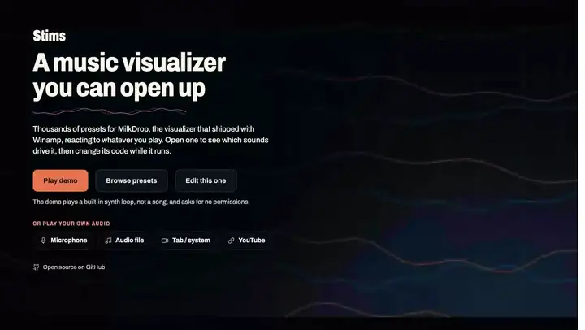
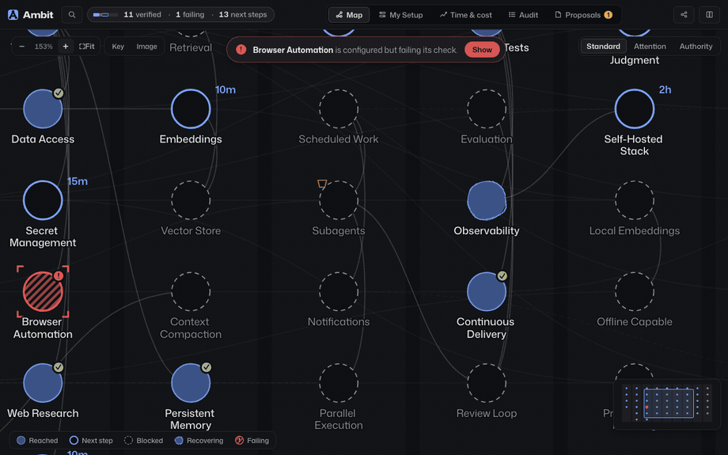
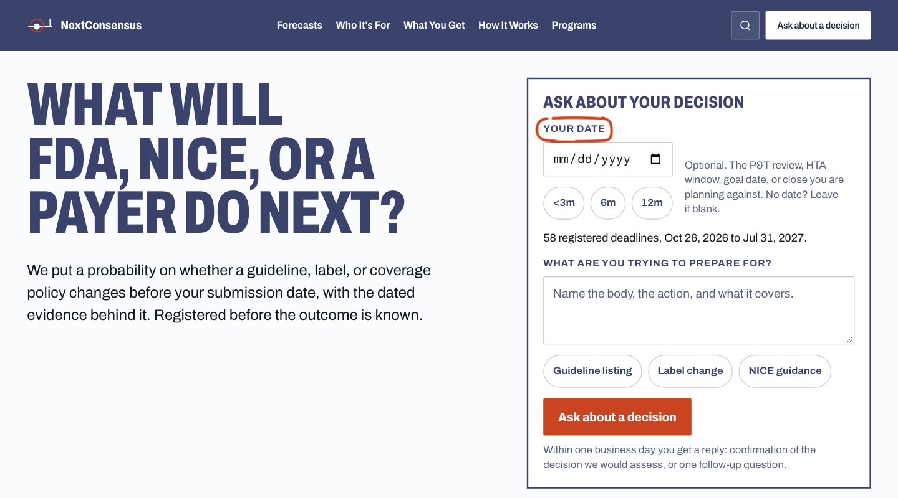

# Kanav Jain

Product lead and engineer. I spent 14 years in healthcare technology, at Epic, Doximity, CancerCompass, Transcarent and Andwise. Since 2024 I've been building the projects below on my own.

  <a href="https://kanav.net">kanav.net</a> ·
  <a href="https://thecrumple.zone">The Crumple Zone</a> ·
  <a href="https://ethotechnics.org">Ethotechnics</a> ·
  <a href="https://x.com/kanavjain">X</a>

## Stims

Play, edit, share. Shown at 2× speed.

Plays the original MilkDrop `.milk` presets in the browser, with no conversion step. The catalog has 1,787 presets, and audio can come from a browser tab, a YouTube link, the microphone, a local file or a built-in demo loop.

The editor opens a preset's source while it runs, with completions, compiler diagnostics, and sliders for zoom, warp, rotation and decay. The address bar holds the whole session, edits included, so a copied link opens the edited preset for anyone. Presets measured as frequent flashers carry a warning and can be hidden. For live sets there is WebMIDI controller mapping, a two-preset cue monitor and a projector window.

Three parts are on npm: `milkdrop-toolchain` (parser, EEL2 interpreter and JIT, shader translation to GLSL and WGSL), `eel-conformance` (82 portable test cases for the preset expression language) and `flash-guard` (WCAG 2.3.1 flash analysis).

[**toil.fyi**](https://toil.fyi) · [zz-plant/stims](https://github.com/zz-plant/stims) · Unlicense

---

## Ambit

Reads the configs of Claude Code, Cursor, OpenCode, Codex CLI and a dozen other agent runtimes into one local graph. From that graph it reports what is one step away, what is worth setting up next, which configured tools pass their checks (`ambit verify`), and what stops working if one piece fails.

Ambit is also an MCP server. An agent can ask what it can do before it tries, and when it hits a limit, propose a config change that waits for your approval.

`npx ambit-cli` or `brew install zz-plant/tap/ambit`

[**Live demo**](https://zz-plant.github.io/ambit/?demo=1) · [zz-plant/ambit](https://github.com/zz-plant/ambit) · MIT

---

## NextConsensus

NextConsensus registers the probability that the FDA, NICE, a guideline committee or a payer acts by a set date. Each forecast is built from that body's own review record, hashed and registered before its deadline, and scored in public once the outcome is adjudicated. It's for market access, HEOR and regulatory teams working to a date.

Refract is the open-source observation engine behind part of this workflow.

[nextconsensus.com](https://nextconsensus.com) · [Registered forecasts](https://nextconsensus.com/forecast/) · [github.com/nextconsensus](https://github.com/nextconsensus)

---

## Other projects

- [Refract](https://github.com/zz-plant/refract): typed change events from wiki revision histories. AGPL-3.0.
- [Whether](https://whether.work): weekly hiring, spend and fundraising guidance from U.S. rate and credit data.
- [Ethotechnics](https://ethotechnics.org): draft standards and tools for correcting automated systems after deployment.
- [The Crumple Zone](https://thecrumple.zone): essays on who pays when institutions get people wrong.

Smaller tools: [tenant-tools](https://github.com/zz-plant/tenant-tools), [bookkit](https://github.com/zz-plant/bookkit), [ci-guards](https://github.com/zz-plant/ci-guards), [cite-checker](https://github.com/zz-plant/cite-checker), [rendered-prose-lint](https://github.com/zz-plant/rendered-prose-lint), [astro-git-revisions](https://github.com/zz-plant/astro-git-revisions) and [fast-harm-slow-repair](https://github.com/zz-plant/fast-harm-slow-repair).

---

## Background

- **Andwise** (2022–24) — co-founder and CEO. Software that read a physician's employment contract and flagged the clauses worth negotiating, with a named reviewer behind every analysis. Raised $240K and reached 1,200+ physician users and a 700-member community; wound down in 2024.
- **Transcarent** (2021–22) — Director of Product, Care Experiences. Directed four specialty-care programs: Surgery, Everyday Urgent Care, Behavioral Health and Oncology Care.
- **CancerCompass** (2019–21) — first product and technical hire at a Cancer Treatment Centers of America venture; led a 14-person R&D team. The platform served 30MM annual visitors; cut bounce rate 25% and lifted chat conversions 267%.
- **NYU Stern** (2019) — MBA.
- **Doximity** (2013–17) — originated Doximity Dialer as founding product lead. Dialer lets a physician call a patient from their own phone while the patient sees the office number, so the call is more likely to be answered and the physician's cell stays private. Nine years after I left, Dialer carries 300,000+ calls on an average workday across 250+ hospitals and health systems, and has ranked first in Best in KLAS for Telehealth Video five years running. I left as Head of Mobile Products & Growth.
- **Epic** (2012–13) — technical services engineer for eight client organizations after installation: worked a 477-bed cancellation risk back to a reference account, brought a 134-year-old health system online, and co-led the PQRS federal quality-reporting group.
- **Georgia Tech** (2009–12) — RNA research; first author on an ACS Symposium Series chapter (Vol. 1082, 2011) on the thermodynamics of sRNA–mRNA interactions.

## Contact

[kanav@kanav.net](mailto:kanav@kanav.net). I especially want to hear from teams putting AI into healthcare workflows.
