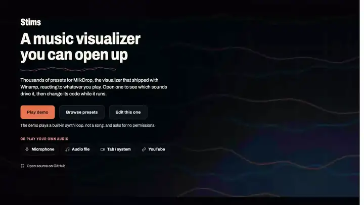
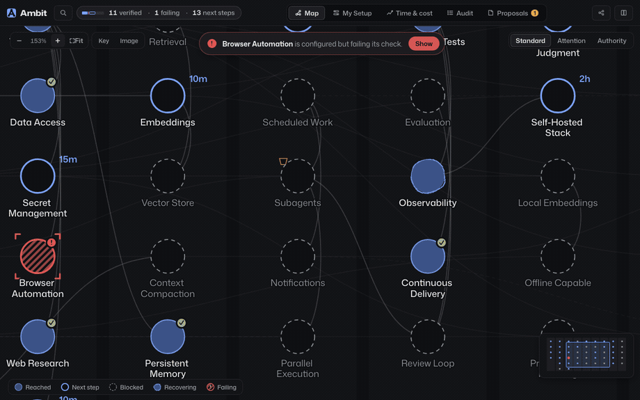
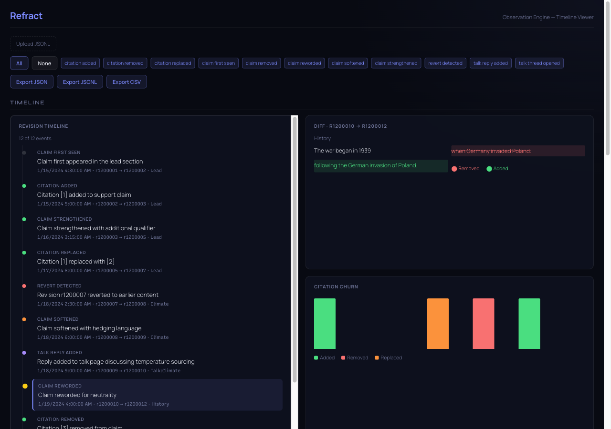
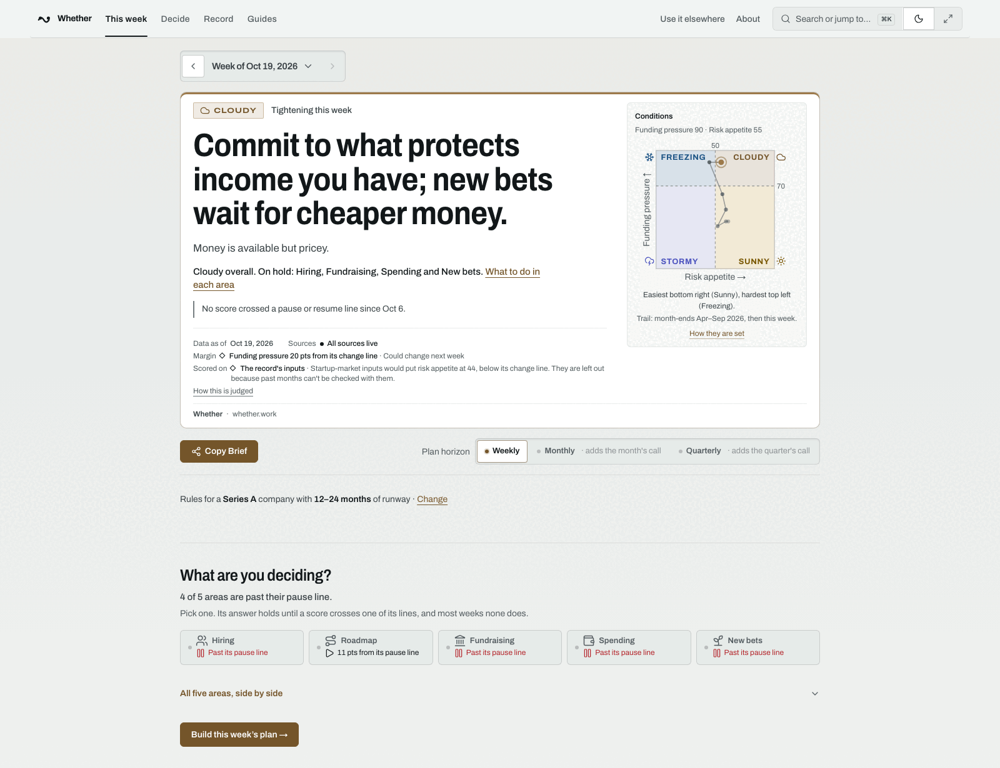
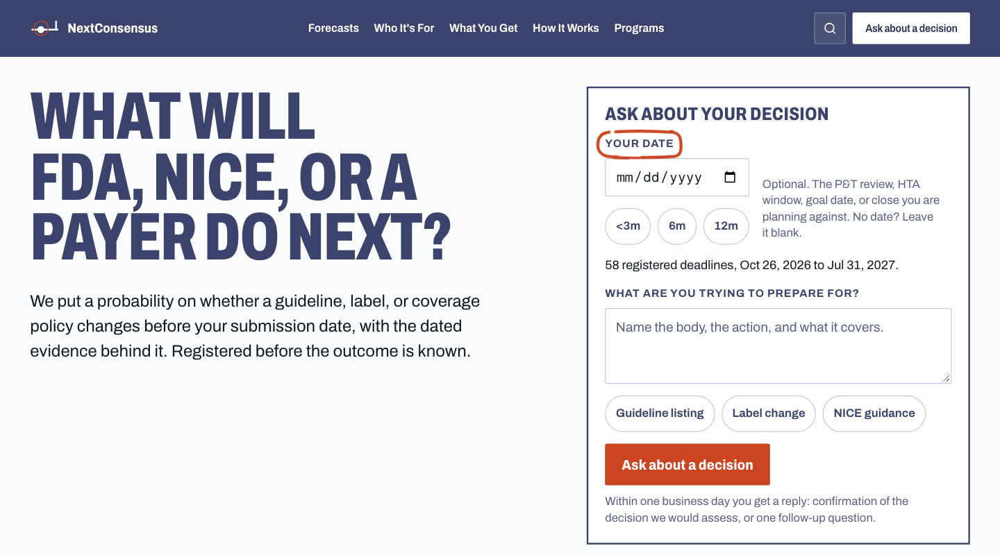
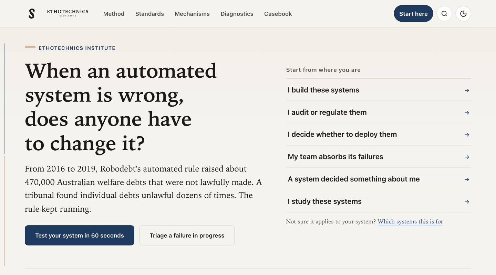
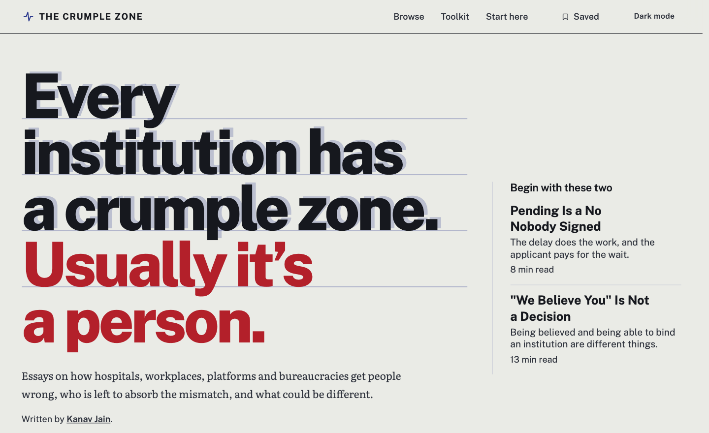

# Kanav Jain

Product lead and engineer. I spent 14 years in healthcare technology, at Epic, Doximity, CancerCompass, Transcarent and Andwise. Since 2024 I've been building the projects below on my own.

  <a href="https://kanav.net">kanav.net</a> ·
  <a href="https://thecrumple.zone">The Crumple Zone</a> ·
  <a href="https://ethotechnics.org">Ethotechnics</a> ·
  <a href="https://x.com/kanavjain">X</a>

| Project | What it is |
|---|---|
| [Stims](#stims) | MilkDrop presets in the browser, editable while they play |
| [Ambit](#ambit) | A map of what your AI agent setup can do, and what one more step would unlock |
| [Refract](#refract) | Typed change events from wiki revision histories |
| [Whether](#whether) | Weekly hiring, spend and fundraising guidance from U.S. rate and credit data |
| [NextConsensus](#nextconsensus) | Registered forecasts of FDA, NICE and payer decisions |
| [Ethotechnics](#ethotechnics) | Draft standards and tools for correcting automated systems after deployment |
| [The Crumple Zone](#the-crumple-zone) | Essays on who pays when institutions get people wrong |

---

## Stims

Play, edit, share. Shown at 2× speed.

Plays the original MilkDrop `.milk` presets in the browser, with no conversion step. The catalog has 1,787 presets, and audio can come from a browser tab, a YouTube link, the microphone, a local file or a built-in demo loop.

The editor opens a preset's source while it runs, with completions, compiler diagnostics, and sliders for zoom, warp, rotation and decay. The address bar holds the whole session, edits included, so a copied link opens the edited preset for anyone. Presets measured as frequent flashers carry a warning and can be hidden. For live sets there is WebMIDI controller mapping, a two-preset cue monitor and a projector window.

Three parts are on npm: `milkdrop-toolchain` (parser, EEL2 interpreter and JIT, shader translation to GLSL and WGSL), `eel-conformance` (82 portable test cases for the preset expression language) and `flash-guard` (WCAG 2.3.1 flash analysis).

[**toil.fyi**](https://toil.fyi) · [zz-plant/stims](https://github.com/zz-plant/stims) · Unlicense

---

## Ambit

Reads the configs of Claude Code, Cursor, OpenCode, Codex CLI and a dozen other agent runtimes into one local graph. From that graph it reports what is one step away, what is worth setting up next, which configured tools pass their checks (`ambit verify`), and what stops working if one piece fails.

Ambit is also an MCP server. An agent can ask what it can do before it tries, and when it hits a limit, propose a config change that waits for your approval.

`npx ambit-cli` or `brew install zz-plant/tap/ambit`

[**Live demo**](https://zz-plant.github.io/ambit/?demo=1) · [zz-plant/ambit](https://github.com/zz-plant/ambit) · MIT

---

## Refract

The timeline viewer, loaded with sample events.

Compares revisions of a MediaWiki page, from Wikipedia or any compatible wiki, and emits a typed event for each change: sentences first seen, reworded, removed or returned; citations added, removed or replaced; section changes, reverts, edit clusters and talk-page activity. The analysis is deterministic: the same revisions, analyzer versions and configuration produce the same events.

`refract review` keeps a watchlist of pages and reports what changed since your last acknowledged review. The CLI (`@refract-org/cli`) also runs as an MCP server, and the repo includes a Python client and the timeline viewer above. A hash-pinned benchmark corpus of 15,926 events across ten Wikipedia pages ships as a release asset.

[refract-org/refract](https://github.com/refract-org/refract) · [Docs](https://refract-org.github.io/refract/) · AGPL-3.0

---

## Whether

<a href="https://whether.work">
  <picture>
    <source media="(prefers-color-scheme: dark)" srcset="docs/assets/whether-dark.png">
    
  </picture>
</a>

Every Monday, Whether scores two things from public U.S. market data: funding pressure (how hard it is to raise and borrow) and risk appetite (how willing investors and buyers are to back growth). The two scores put the week in one of four conditions, Sunny, Cloudy, Stormy or Freezing, and the brief says what that means for hiring, spending and raising.

Each call comes with the interest-rate and credit lines that would pause or resume it, and subscribers get an email the day one is crossed. It's free, and agents can query it over MCP at `https://whether.work/api/mcp` with no key.

[**whether.work**](https://whether.work) · [zz-plant/whether](https://github.com/zz-plant/whether) · MIT

---

## NextConsensus

NextConsensus registers the probability that the FDA, NICE, a guideline committee or a payer acts by a set date. Each forecast is built from that body's own review record, hashed and registered before its deadline, and scored in public once the outcome is adjudicated. It's for market access, HEOR and regulatory teams working to a date.

Refract is the open-source observation engine behind part of this workflow.

[nextconsensus.com](https://nextconsensus.com) · [Registered forecasts](https://nextconsensus.com/forecast/) · [github.com/nextconsensus](https://github.com/nextconsensus)

---

## Ethotechnics

ethotechnics.org publishes material for keeping automated systems correctable once they're deployed:

- ten draft standards with numbered clauses, including STD-08 Delegation and STD-09 Agent chains
- blueprints for decision logs, kill switches, appeal paths and authority registers
- evaluation suites that test whether a deployed system can be corrected
- self-assessment diagnostics

The standards are crosswalked to NIST AI RMF, ISO/IEC 42001 and the EU AI Act.

[**ethotechnics.org**](https://ethotechnics.org) · [zz-plant/ethotechnics.org](https://github.com/zz-plant/ethotechnics.org) · CC BY-SA 4.0

---

## The Crumple Zone

Essays on what happens when hospitals, employers, platforms and agencies get people wrong: who pays for the mistake, and who can make them fix it. More than 200 so far. The site and its newsletter run on a publishing stack I built on Cloudflare Workers, D1 and Queues.

[**thecrumple.zone**](https://thecrumple.zone)

---

## Smaller tools

| Repo | What it does | License |
|---|---|---|
| [zz-plant/tenant-tools](https://github.com/zz-plant/tenant-tools) | Tenants in one building log repairs, join an existing issue with "me too", and generate neutral notices. Live at [tenants.kanav.net](https://tenants.kanav.net) | — |
| [zz-plant/bookkit](https://github.com/zz-plant/bookkit) | Compiles a nonfiction book written in MDX into a searchable site, PDF, EPUB and MCP endpoint, checking each record against its contract before it builds | CC0-1.0 |
| [zz-plant/ci-guards](https://github.com/zz-plant/ci-guards) | CI gates for TypeScript and Bun: block network access in `bun test`, audit `<main>` landmarks and skip links, fail on new suppressions | — |
| [zz-plant/cite-checker](https://github.com/zz-plant/cite-checker) | Checks that the sources behind a site's claims still answer, and publishes the result | MIT |
| [zz-plant/rendered-prose-lint](https://github.com/zz-plant/rendered-prose-lint) | Prose checks that run on a static site's built HTML | MIT |
| [zz-plant/astro-git-revisions](https://github.com/zz-plant/astro-git-revisions) | Per-page revision dates from the git log for Astro sites | MIT |
| [zz-plant/fast-harm-slow-repair](https://github.com/zz-plant/fast-harm-slow-repair) | Draft evaluation protocol: does a healthcare AI workflow stay correctable after its record becomes wrong? | MIT |

---

## Background

- **Andwise** (2022–24) — co-founder and CEO. Software that read a physician's employment contract and flagged the clauses worth negotiating, with a named reviewer behind every analysis. Raised $240K and reached 1,200+ physician users and a 700-member community; wound down in 2024.
- **Transcarent** (2021–22) — Director of Product, Care Experiences. Directed four specialty-care programs: Surgery, Everyday Urgent Care, Behavioral Health and Oncology Care.
- **CancerCompass** (2019–21) — first product and technical hire at a Cancer Treatment Centers of America venture; led a 14-person R&D team. The platform served 30MM annual visitors; cut bounce rate 25% and lifted chat conversions 267%.
- **NYU Stern** (2019) — MBA.
- **Doximity** (2013–17) — originated Doximity Dialer as founding product lead. Dialer lets a physician call a patient from their own phone while the patient sees the office number, so the call is more likely to be answered and the physician's cell stays private. Nine years after I left, Dialer carries 300,000+ calls on an average workday across 250+ hospitals and health systems, and has ranked first in Best in KLAS for Telehealth Video five years running. I left as Head of Mobile Products & Growth.
- **Epic** (2012–13) — technical services engineer for eight client organizations after installation: worked a 477-bed cancellation risk back to a reference account, brought a 134-year-old health system online, and co-led the PQRS federal quality-reporting group.
- **Georgia Tech** (2009–12) — RNA research; first author on an ACS Symposium Series chapter (Vol. 1082, 2011) on the thermodynamics of sRNA–mRNA interactions.

## Contact

[kanav@kanav.net](mailto:kanav@kanav.net). I especially want to hear from teams putting AI into healthcare workflows.
